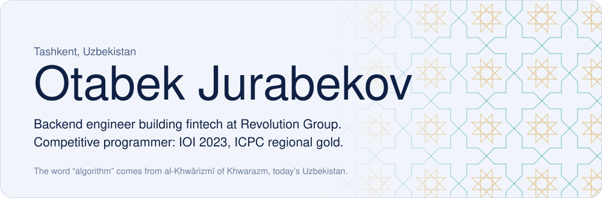
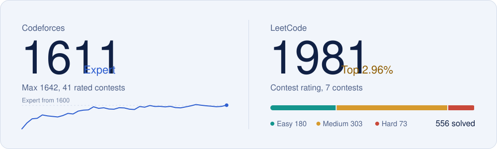
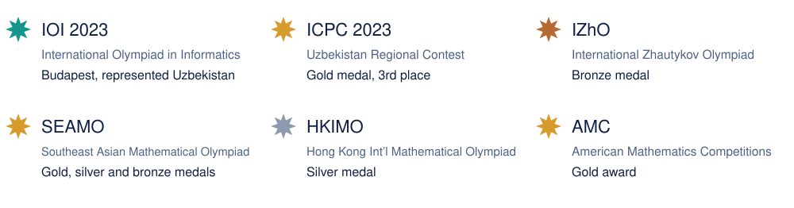
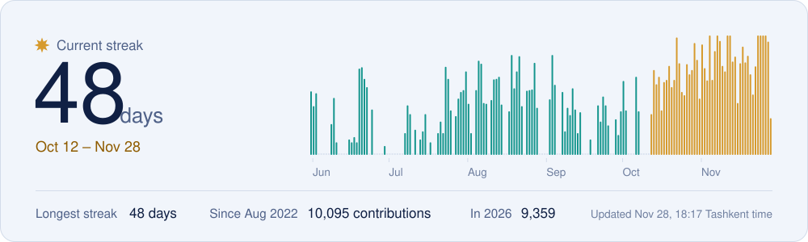

<picture>
  <source media="(prefers-color-scheme: dark)" srcset="https://raw.githubusercontent.com/OtabekJurabekov/OtabekJurabekov/output/hero-dark.svg">
  
</picture>

  <a href="https://codeforces.com/profile/OtabekJurabekov"><b>Codeforces</b></a>&emsp;
  <a href="https://leetcode.com/u/OtabekJurabekov/"><b>LeetCode</b></a>&emsp;
  <a href="https://www.linkedin.com/in/otabek-jurabekov-290302225/"><b>LinkedIn</b></a>&emsp;
  <a href="https://ilmora.uz"><b>ilmora.uz</b></a>&emsp;
  <a href="mailto:otabekjurabekov3@gmail.com"><b>otabekjurabekov3@gmail.com</b></a>

I'm a backend developer at **Revolution Group** in Samarqand, where I build and run the services behind **Yubor** and **Tezpay**, two fintech apps that handle real transactions. That work is mostly APIs, third-party integrations, data modeling and keeping things fast and up in production.

Before that I spent three years on the backend of **Asaxiy**, one of Uzbekistan's largest e-commerce platforms. I also compete: I represented Uzbekistan at **IOI 2023** in Budapest, won gold at the **ICPC Uzbekistan Regional**, and solve on Codeforces and LeetCode.

On the side I'm building **[ilmora.uz](https://ilmora.uz)**, an AI-powered vocabulary learning app, and studying software engineering at **PDP University** in Tashkent.

## Competitive programming

<picture>
  <source media="(prefers-color-scheme: dark)" srcset="https://raw.githubusercontent.com/OtabekJurabekov/OtabekJurabekov/output/competitive-dark.svg">
  
</picture>

<picture>
  <source media="(prefers-color-scheme: dark)" srcset="https://raw.githubusercontent.com/OtabekJurabekov/OtabekJurabekov/output/honors-dark.svg">
  
</picture>

## Contributions

<picture>
  <source media="(prefers-color-scheme: dark)" srcset="https://raw.githubusercontent.com/OtabekJurabekov/OtabekJurabekov/output/contributions-dark.svg">
  
</picture>

<picture>
  <source media="(prefers-color-scheme: dark)" srcset="https://raw.githubusercontent.com/OtabekJurabekov/OtabekJurabekov/output/snake-dark.svg">
  
</picture>

## Experience

**Backend developer, Revolution Group** 
May 2025 – present, Samarqand 
Backend services for the Yubor and Tezpay fintech apps: REST API design, third-party payment integrations, performance work and production reliability. PHP, PostgreSQL, Redis, Docker, Linux.

**Backend developer, Asaxiy** 
May 2022 – April 2025, Tashkent 
Core backend modules for one of Uzbekistan's largest e-commerce platforms: data modeling, API architecture and scaling.

## Education

**PDP University**, B.Sc. Software Development 
September 2024 – present, Tashkent

**National University of Uzbekistan**, B.Sc. Finance 
September 2023 – May 2024, Tashkent

## Stack

<picture>
  <source media="(prefers-color-scheme: dark)" srcset="https://raw.githubusercontent.com/OtabekJurabekov/OtabekJurabekov/main/assets/stack-dark.svg">
  
</picture>

 

The cards above rebuild every hour from GitHub, Codeforces and LeetCode data ([workflow](https://github.com/OtabekJurabekov/OtabekJurabekov/blob/main/.github/workflows/profile-cards.yml)).&emsp;
